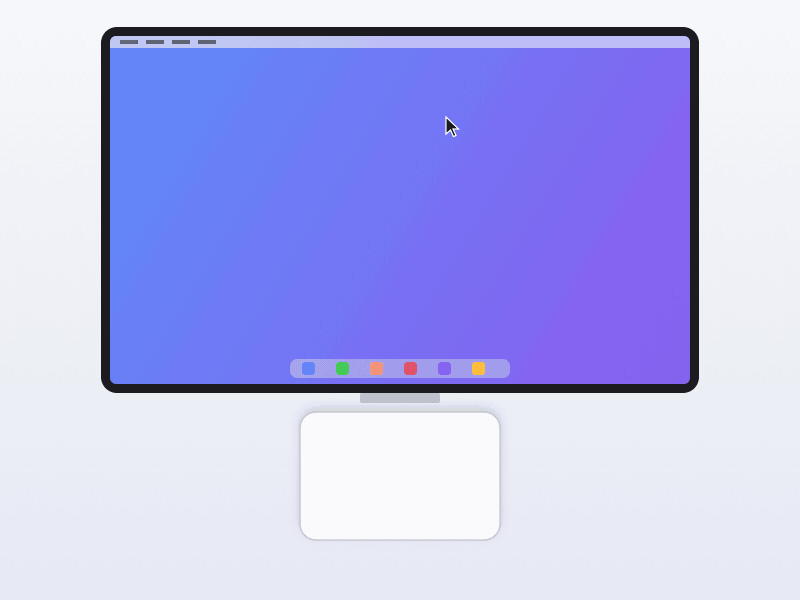

  

# Swipe

Range tes fenêtres macOS avec un **swipe à deux doigts sur la barre de titre**.

  

| Swipe sur la barre de titre | Résultat |
|---|---|
| ← / → | moitié gauche / droite de l'écran |
| ↑ | remplir l'écran (sans plein écran macOS) |
| ↖ ↗ ↙ ↘ | quart d'écran |
| ↓ | réduire dans le Dock |
| pincer (deux doigts qui se rapprochent, comme pour dézoomer) | fermer la fenêtre |
| deux doigts posés un instant, puis ↑ | plein écran macOS (le même geste pour en sortir) |

Pendant le geste, la fenêtre se déplace en direct, et une petite vignette près du curseur montre où elle va. On peut changer d'avis tant que les doigts sont posés, ou revenir au point de départ pour annuler. Partout ailleurs que sur une barre de titre, le défilement marche normalement.

Réglages : lancement au démarrage, sensibilité du geste, choix de l'aperçu, mises à jour automatiques.

## Installation

1. Télécharge le dernier **`Swipe-x.y.dmg`** dans [Releases](https://github.com/Nic0vd/Swipe/releases/latest).
2. Ouvre le DMG et glisse **Swipe** dans **Applications**.
3. **Premier lancement** : Swipe n'est pas validée (« notarisée ») par Apple, donc macOS bloque l'ouverture la première fois. Va dans **Réglages Système → Confidentialité et sécurité**, puis clique sur **Ouvrir quand même** en face de Swipe.
4. Autorise Swipe dans **Réglages Système → Confidentialité et sécurité → Accessibilité**. C'est indispensable pour qu'elle puisse déplacer les fenêtres.

Swipe vit dans la barre des menus (icône en forme de main). Les mises à jour suivantes s'installent toutes seules, avec [Sparkle](https://sparkle-project.org).

**Configuration requise** : macOS 27.2 ou plus récent, et un trackpad.

## Pour les curieux

App SwiftUI pour la barre des menus. Elle écoute les défilements du trackpad (`CGEventTap`) et déplace les fenêtres via l'API d'accessibilité de macOS. Les choix de conception sont expliqués dans [CLAUDE.md](CLAUDE.md).
