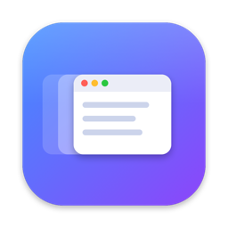
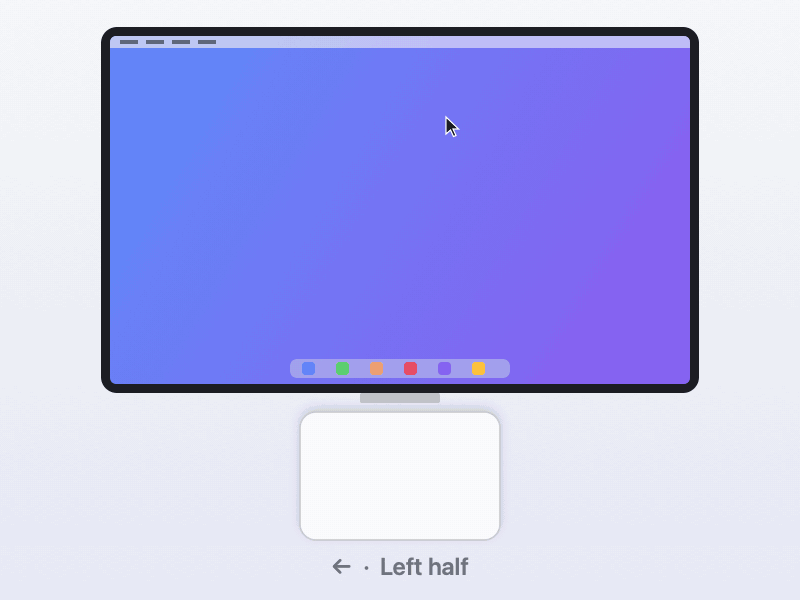

  

  <b>🇬🇧 English</b> · <a href="README.fr.md">🇫🇷 Français</a>

# Swipe

Arrange your macOS windows with a **two-finger swipe on the title bar**.

  

| On the title bar | Result |
|---|---|
| ← / → | left / right half of the screen |
| ↑ | fill the screen (without macOS full screen) |
| ↖ ↗ ↙ ↘ | quarter of the screen |
| ↓ | minimize to the Dock |
| pinch (two fingers coming together, as if zooming out) | close the window |
| rest two fingers for a moment, then ↑ | macOS full screen (same gesture to exit) |

While you swipe, the window moves live, and a small thumbnail next to the pointer shows where it will land. You can change your mind as long as your fingers are down, or come back to where you started to cancel. Anywhere other than a title bar, scrolling works as usual.

**Settings**: launch at login, gesture sensitivity, preview style, haptic feedback in the trackpad, margins around windows. A **Gestures** tab shows every gesture as an animation.

## Installation

1. Download the latest **`Swipe-x.y.dmg`** from [Releases](https://github.com/Nic0vd/Swipe/releases/latest).
2. Open the DMG and drag **Swipe** into **Applications**.
3. **First launch**: Swipe isn't notarized by Apple, so macOS blocks it the first time. Go to **System Settings → Privacy & Security** and click **Open Anyway** next to Swipe.
4. Allow Swipe in **System Settings → Privacy & Security → Accessibility**. It needs this to move windows.

Swipe lives in the menu bar (hand icon). Later updates install themselves, thanks to [Sparkle](https://sparkle-project.org).

**Requirements**: macOS 15 (Sequoia) or later, and a trackpad. Swipe is available in English and French, following your Mac's language.

## Under the hood

A SwiftUI menu bar app. It listens to trackpad scroll events (`CGEventTap`) and moves windows through the macOS Accessibility API.
